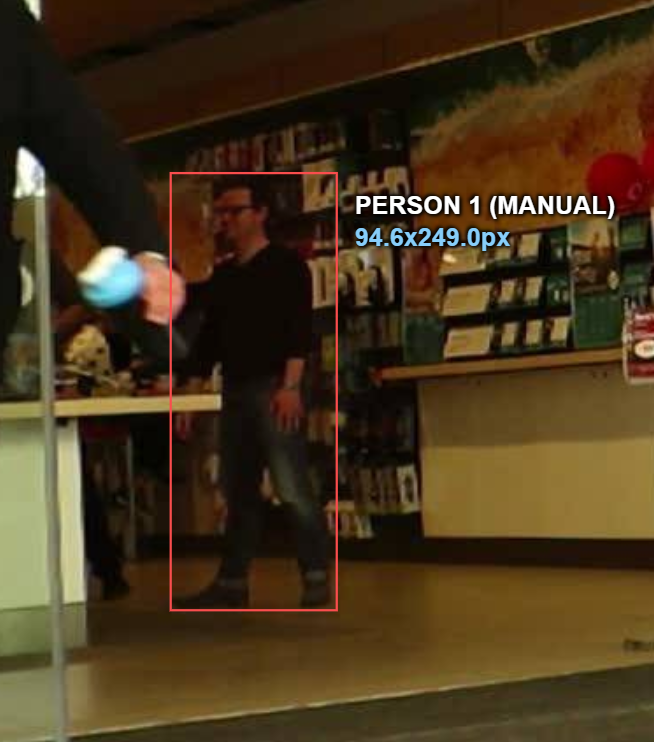
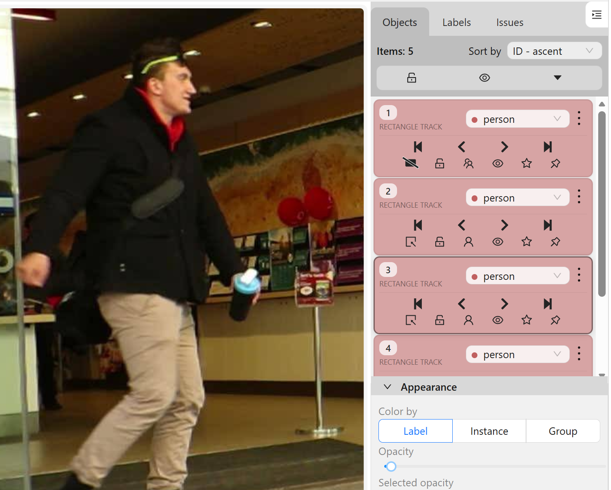
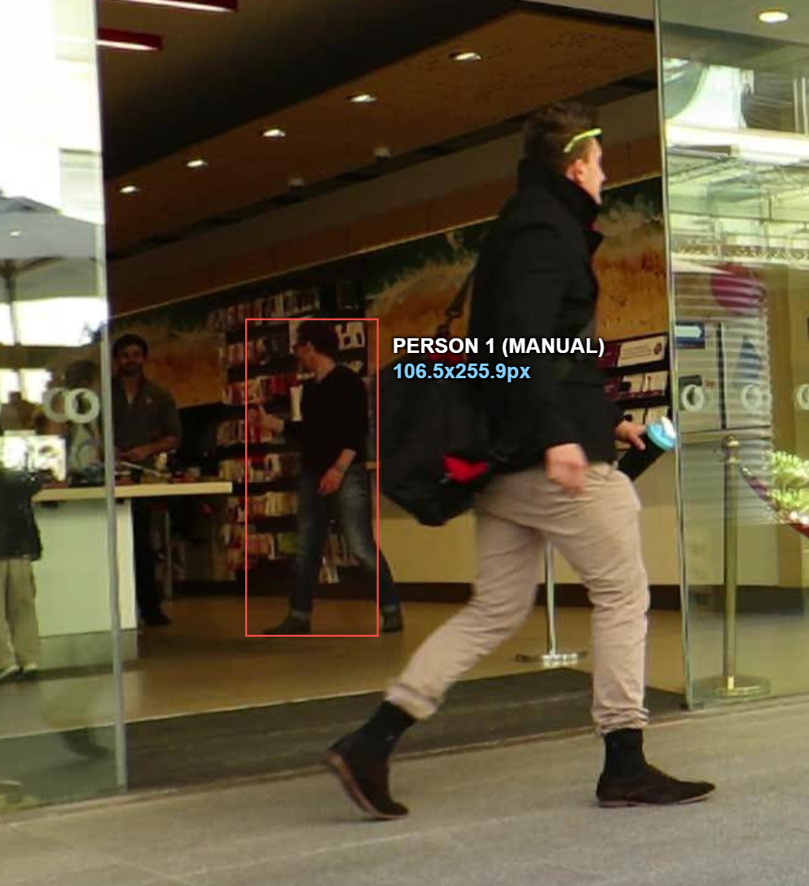

# Báo cáo cá nhân — PhamTienPhat-2A202603063

Đoạn video: MOT17-09, 150 frame (frame 1–150), nguồn MOTChallenge, giấy phép CC BY-NC-SA 3.0.

## 0. Thông tin học viên

- Họ tên: Phạm Tiến Phát
- MSSV: 2A202603063
- Mã đề (A/B/C): B (task `DAY05-MOT17-09-B-2A202603063`)
- Email: s7phatnm@gmail.com
- Link repository:https://github.com/Fat137/K5-L2-DAY05-PhamTienPhat-03063-MOTTracking
- Giờ bắt đầu: 16:45, 13/11/2026
- Giờ kết thúc: 18:45, 13/11/2026

## 1. Xem trước đoạn video (CP0)

Ghi **trước khi vẽ**, mỗi người một dòng.

| Mã | Frame xuất hiện | Frame cuối thấy được | Rẽ / dừng / đổi tốc độ ở frame | Bị che ở frame | Ghi chú |
|---|---|---|---|---|---|
| P1 | 0 | 149 | Không | 27–54 | Người trong cửa hàng Vodafone, sau lớp kính; người bị che dùng cho CP2 |
| P2 | 0 | 149 | Không | Không | Áo khoác xanh lá, quần đen, xách túi đen |
| P3 | 0 | 149 | Không | Không | Áo sơ mi xanh dương, mũ trắng; f0 chỉ thấy tay ở mép phải, đi vào khung dần (frame tham chiếu f40) |
| P4 | 0 | 149 | 30-149 | 106–138, 143–149 | Em bé mặc đồ trắng, đi sát P5 → dễ `id_switch` / `merge` |
| P5 | 0 | 149 | 30-149 | 96–149 | Người lớn áo xám, túi hồng, đi cùng P4 (frame tham chiếu f2) |

Các mốc trên ghi khi xem từng frame trước khi vẽ. Mốc cờ `occluded` / `outside` cuối cùng (sau khi gán và tự review) ghi ở mục 2 và mục 3.

## 2. Keyframe và thời gian (CP1, CP4)

Số keyframe lấy từ kết quả `src/check_submission.py`.

| Mã | Số keyframe | Keyframe ở frame | Số frame có mặt | Keyframe / 100 frame | Thời gian (phút) | Chỗ khó |
|---|---|---|---|---|---|---|
| P1 | 19 | 0, 10, 20, 27, 30, 40, 44, 50, 55, 60, 70, 80, 90, 100, 110, 120, 130, 140, 149 | 148 | 12,8 | — | Bị người đi phía trước che f27–54, mất hẳn f42–43 |
| P2 | 16 | 0, 10, 20, …, 140, 149 (mỗi 10 frame) | 150 | 10,7 | — | Túi xách bên hông: giữ cách bao box nhất quán |
| P3 | 16 | 0, 10, 20, …, 140, 149 (mỗi 10 frame) | 150 | 10,7 | — | Đi vào từ mép phải: đầu đoạn chỉ thấy cánh tay, box chỉ bao phần thấy được và mở rộng dần, không bật cờ |
| P4 | 15 | 0, 10, 20, 30, 40, 50, 70, 100, 106, 110, 136, 139, 140, 143, 144 | 122 | 12,3 | — | Đứng sát P5; bị che f106–146, mất hẳn f111–135 và từ f147 |
| P5 | 9 | 0, 10, 20, 30, 40, 50, 70, 100, 102 | 106 | 8,5 | — | Đứng sát P4; bị che từ f102, mất hẳn từ f106 đến hết đoạn |
| **Tổng** | **75** | | **676** | **11,1** | **90** | |

Thời gian: tôi gán song song cả 5 người (mỗi bước 10 frame chỉnh lần lượt cả 5 box) nên không tách được thời gian riêng từng người; chỉ ghi tổng thời gian gán CP1. Toàn bài: 16:45–18:45 = 120 phút.

Keyframe / 100 frame của cả bài = tổng keyframe ÷ tổng số frame có mặt × 100 = 75 ÷ 676 × 100 = **11,1**

Bạn đặt keyframe nhiều nhất ở người nào? Vì sao (người đó rẽ, dừng, lại gần camera hay bị che)?

P1 (19 keyframe), vì P1 bị che trong đoạn f27–54: cần keyframe ngay trước khi bị che (f27), khi mất hẳn (f42), khi hiện lại (f44) và khi thấy rõ trở lại (f55).

## 3. Đoạn bị che (CP2)

Người bị che: `P1`

| Mốc | Frame |
|---|---:|
| Bắt đầu bị che một phần (bật `occluded`) | 27 |
| Mất hẳn (bật `outside`) | 42 |
| Hiện lại (tắt `outside`) | 44 |
| Thấy rõ trở lại (tắt `occluded`) | 55 |

- Thời gian khuất hẳn: 2 frame (f42–43) = 0,07 giây.
- Quyết định: giữ cùng ID.
- Lý do (trả lời 3 câu: khuất bao lâu so với 60 frame, ngoại hình có khớp, chỗ hiện lại có đúng hướng và tốc độ):
  1. P1 chỉ khuất hẳn 2 frame (f42–43 = 0,07 s), nhỏ hơn rất nhiều so với ngưỡng 60 frame.
  2. Người hiện lại ở f44 có ngoại hình khớp với P1 trước khi bị che: chiều cao vẫn tầm đó, quần áo cũng y nguyên, màu cũ, có đeo kính.
  3. Chỗ hiện lại khớp với hướng đi cũ: box f44 gần như trùng vị trí box f42 (x ≈ 333). P1 vẫn đi đều sang phải trong suốt đoạn f27–55 với kích thước box không đổi, nên đây là cùng một người đi tiếp sau người che phía trước.
  → Cả 3 điều kiện đều thoả, nên giữ cùng track và cùng ID.

Ảnh chụp màn hình:





Nguồn ảnh: MOT17, MOTChallenge (Milan et al., 2016).

## 4. Tự review ID (CP3)

Lượt 1 theo người (đi ngược từ frame 149 về 0 trên CVAT), lượt 2 theo cảnh (nhảy 10 frame). Ít nhất 3 dòng; không có lỗi thì ghi một dòng "đã kiểm hai lượt, không lỗi".

Loại lỗi dùng đúng một trong 7 mã: `id_switch`, `fragmentation`, `lost`, `merge`, `false_track`, `drift`, `flag`.

| Frame | Mã người | Loại lỗi | Mô tả một câu | Phát hiện ở lượt | Đã sửa? |
|---:|---|---|---|---|---|
| 55-59 | P1 | `flag` | P1 đã thấy rõ trở lại nhưng vẫn còn bật `occluded` (thừa cờ) | Lượt 1 | Có |
| 42–43 | P1 | `flag` | P1 bị che kín nhưng chỉ bật `occluded`, thiếu `outside` | Đối chiếu kết quả script (CP4) | Có, bật `outside` f42, tắt ở f44 |
| 111–135, 147–149 | P4 | `flag` | Đoạn P4 mất hẳn chỉ bật `occluded`, thiếu `outside` | Đối chiếu kết quả script (CP4) | Có |
| 106–149 | P5 | `flag` | Đoạn P5 mất hẳn chỉ bật `occluded`, thiếu `outside` | Đối chiếu kết quả script (CP4) | Có |
| 0–149 | P1–P5 | — | Lượt 2: đã kiểm theo cảnh mỗi 10 frame, không thấy ID đổi người, box thừa hay thiếu | Lượt 2 | — |

Tổng hợp số lỗi theo loại:

| `id_switch` | `fragmentation` | `lost` | `merge` | `false_track` | `drift` | `flag` |
|---:|---:|---:|---:|---:|---:|---:|
| 0 | 0 | 0 | 0 | 0 | 0 | 4 |

Lỗi nào chỉ lượt 2 (theo cảnh) mới thấy, lượt 1 (theo người) không thấy? Vì sao?

Không có lỗi nào chỉ lượt 2 mới thấy: rà lượt 2 không phát hiện lỗi. Ba lỗi thiếu `outside` (P1, P4, P5) tôi chỉ biết khi xem kết quả script ở CP4, rồi mới quay lại CVAT sửa.

## 5. File xuất và kết quả tự kiểm (CP4)

| Kiểm tra | Kết quả |
|---|---|
| Tên file MOT 1.1 | `src/exports/PhamTienPhat_mot.zip` |
| Tên file CVAT for video 1.1 | `src/exports/PhamTienPhat_cvat_video.zip` |
| Số track ID khác nhau trong `gt/gt.txt` (phải là 5) | 5 |
| Frame `outside` không có dòng trong `gt.txt` (đúng / sai) | Đúng (ID 1 không có dòng ở f42–43; ID 4 ở f111–135 và f147–149; ID 5 từ f106) |
| Job đã completed trên CVAT máy cá nhân | Có |

Dán phần tóm tắt in ra từ `src/check_submission.py`:

```text
=== File MOT 1.1: PhamTienPhat_mot.zip ===
  Số track ID: 5   |   Tổng số box: 676
  [OK]        Đúng 5 track ID.

  Track | Frame có mặt | Số frame | Đoạn vắng (outside)
      1 |   0–149      |      148 | 42–43
      2 |   0–149      |      150 | -
      3 |   0–149      |      150 | -
      4 |   0–146      |      122 | 111–135
      5 |   0–105      |      106 | -

=== File CVAT for video 1.1: PhamTienPhat_cvat_video.zip ===
  Track | Nhãn   | Frame thấy | Keyframe | KF/100 frame | Frame occluded | Lần bật outside
      0 | person |        148 |       19 |         12.8 |             26 |               1
      1 | person |        150 |       16 |         10.7 |              0 |               0
      2 | person |        150 |       16 |         10.7 |              0 |               0
      3 | person |        122 |       15 |         12.3 |             12 |               2
      4 | person |        106 |        9 |          8.5 |              4 |               1

  Tổng: 75 keyframe / 676 frame có mặt = 11.1 keyframe / 100 frame
  [OK]        Đọc được 5 track từ annotations.xml.

=== Tóm tắt ===
  Lỗi: 0   |   Cảnh báo: 0
  Đạt. Dán phần tóm tắt này vào báo cáo mục 5.
```

## 6. Ba câu kết

1. Nếu được gán lại, bạn sẽ đặt keyframe khác ở đâu? Vì sao?

   P2 và P3 có keyframe đều đúng mỗi 10 frame (0, 10, 20, …, 149) vì tôi chỉnh box ở mọi bước `V`, tức là đặt theo nhịp tua chứ không theo chỗ chuyển động thay đổi. Gán lại, với P2 (đi thẳng đều) tôi chỉ giữ keyframe ở đầu, cuối và vài điểm kiểm, rồi tua `F` xem box có trôi không; với P3 tôi đặt dày ở f0–40 khi người đang đi vào từ mép phải (box rộng ra nhanh, nội suy tuyến tính dễ lệch) và thưa hơn sau khi đã thấy đủ thân. Ngoài ra, ở frame P1 hiện lại tôi sẽ kiểm tra cờ ngay, để không để sót `occluded` ở f55–59 như lần này.

2. Có chỗ nào bạn không chắc "cùng ID hay ID mới"? Bạn đã quyết định và ghi chú thế nào?

   P1 chỉ khuất hẳn 2 frame (f42–43) nên quyết định giữ cùng ID khá rõ ràng. Chỗ cần cân nhắc hơn là P4: em bé khuất hẳn 25 frame (f111–135) rồi hiện lại ở f136. Tôi giữ cùng track vì 25 frame < ngưỡng 60 frame, em bé hiện lại đúng chỗ cũ (box gần như không đổi vị trí và kích thước) và vẫn đứng cạnh P5. Chỗ tôi phân vân thật sự là P3 ở đầu đoạn: f0 chỉ thấy một cánh tay ở mép phải. Tôi quyết định bắt đầu track từ f0 vì thấy tay to dần liên tục thành cùng một người, box chỉ bao phần thấy được và không bật cờ; ghi chú ở mục 1 và mục 2.

3. Một lỗi ID trong job của bạn (nếu không còn sót, chọn lỗi đã sửa) có thể làm xe tự lái dự đoán sai chuyển động của người đó như thế nào? Lỗi đó ảnh hưởng MOTA hay IDF1 nhiều hơn?

   Lỗi tôi đã sửa: P4 mất hẳn ở f111–135 nhưng ban đầu chỉ bật `occluded`, nên nhãn vẫn có box của em bé đứng yên ở chỗ đó suốt 25 frame. Dữ liệu này dạy hệ thống rằng có một em bé đứng yên và nhìn thấy được, trong khi thực tế em bé đang bị che và có thể di chuyển phía sau vật che; mô hình ReID còn học nhầm hình ảnh của vật che là P4. Vì ID không đổi, lỗi này chủ yếu làm tăng FP (GT bỏ các frame `visibility = 0`), nên ảnh hưởng MOTA rõ hơn; IDF1 giảm ít hơn vì P4 vẫn giữ một ID suốt đoạn. Nếu ngược lại tôi tạo track mới cho P4 ở f136 (hoặc đổi ID với P5 lúc hai người đứng sát), xe sẽ mất lịch sử vận tốc của em bé và coi đó là người mới xuất hiện; lỗi đó chỉ cộng 1 IDSW nên MOTA gần như không đổi, nhưng IDF1 giảm nhiều vì cả đoạn sau mang sai ID.

## Bonus (nếu làm)

Không làm phần bonus.

## 7. Tài liệu tham khảo và công cụ AI đã dùng

- Dữ liệu: MOT17, MOTChallenge (Milan et al., 2016), giấy phép CC BY-NC-SA 3.0.
- Tài liệu của lab: `docs/GUIDELINE.md`, `docs/MOT_FORMAT.md`, `docs/CVAT_CHEATSHEET.md`.
- Công cụ AI: Claude Code (Claude Opus 5.5). Dùng để sửa lỗi cài thư viện Python, giải thích quy ước gán nhãn (`occluded` / `outside`, keyframe, người đi vào từ mép ảnh), chạy `src/check_submission.py` và đọc kết quả, định dạng các bảng của báo cáo từ số liệu của tôi. Không dùng AI để sinh box hay track ID; toàn bộ nhãn trên CVAT do tôi gán tay.
